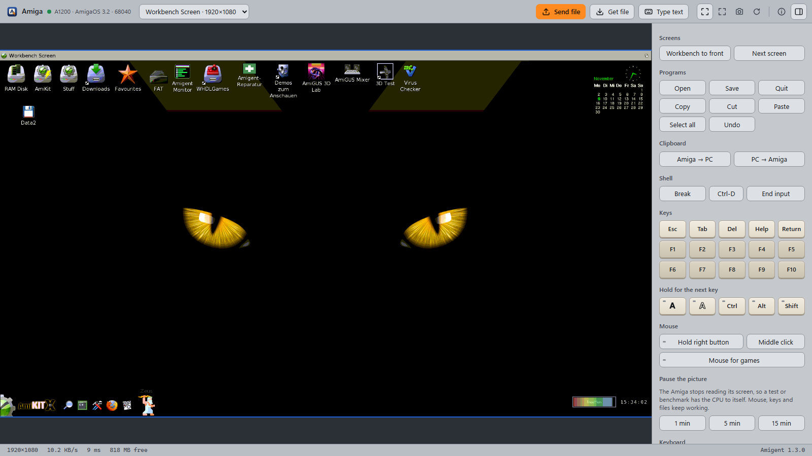
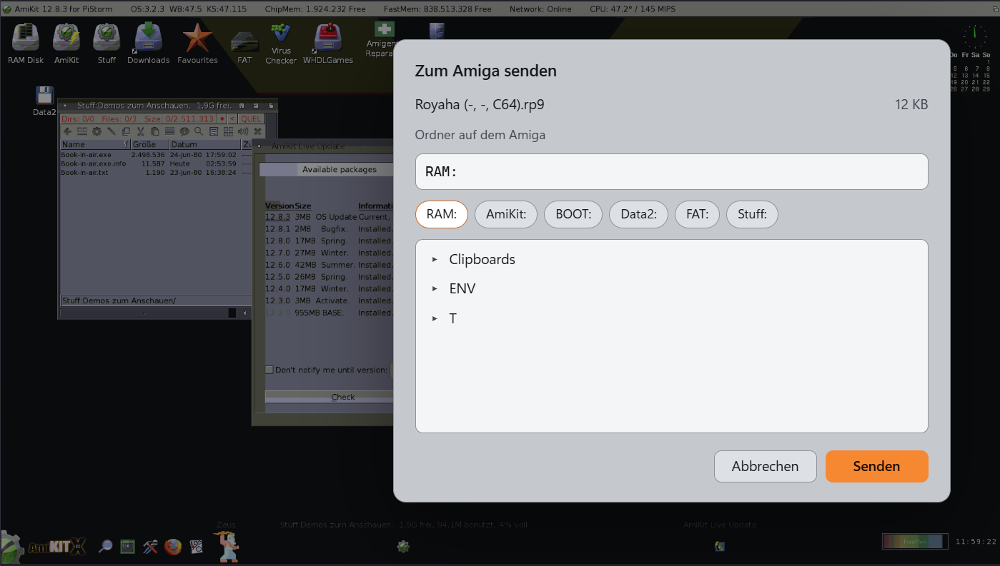
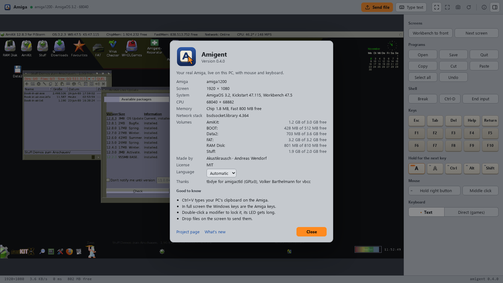

```
     _____            .__                            __
    /  _  \    _____  |__|   ____    ____    ____  _/  |_
   /  /_\  \  /     \ |  |  / ___\ _/ __ \  /    \ \   __\
  /    |    \|  Y Y  \|  | / /_/  >\  ___/ |   |  \ |  |
  \____|__  /|__|_|  /|__| \___  /  \___  >|___|  / |__|
          \/       \/     /_____/       \/      \/

     complete remote control for a real Amiga, by AI or by hand
```

<p align="center"></p>

Amigent lets you remote-control a real Amiga completely from your PC, either
through an AI agent or by hand. It works over the local network and has two parts:

1. **Control by AI.** An MCP server gives an AI agent such as Claude Code or
   Codex full access to the Amiga: Shell commands, files, installing and updating
   software, settings and menus, and the screen with mouse and keyboard for
   programs that need it. Any agent that supports MCP can use it.
2. **Remote desktop for control by hand.** A window on the PC shows the Amiga's
   screen live. You use it with your own mouse and keyboard, send Amiga key
   combinations from a side panel and copy files to a folder of your choice.

Both work at the same time and share one connection to the Amiga.

By Andreas Wendorf (Akustikrausch).

## Requirements

Amiga: AmigaOS 3.x, a 68040 or faster (for example a PiStorm), an RTG graphics
card, a TCP/IP stack such as Roadshow, and a network connection. A plipbox on the
parallel port is enough.

PC: Python 3.10 or newer, and an AI agent with MCP support, for example
[Claude Code](https://claude.com/claude-code) or
[Codex](https://github.com/openai/codex). The remote desktop uses Edge or Chrome
and works without an AI agent.

## Installation

**1. Copy one file to the Amiga**

[`amiga/bin/amigentd`](amiga/bin/amigentd), about 14 KB, for example to `RAM:`.
Any way works: browser, USB stick, SD card, null modem cable.

**2. Start it in a Shell**

    RAM:amigentd SETUP

**3. Let your AI agent do the rest**

Paste this into your AI agent:

    Install Amigent from https://github.com/akustikrausch/amigent for me.
    Clone it, run pip install -e . in it, then run amigent-setup. It finds my
    Amiga by itself and prints the address. Register the MCP server "amigent"
    with the command amigent-server and the environment variable
    AMIGENT_HOST=<address>. If I'm on Windows, also run
    amigent-viewer <address> --install. Tell me if you need to be restarted.

`amigent-setup` looks for the Amiga on the local network, downloads the current
[amigactld](https://github.com/tbdye/amigactl) from its project page, copies both
services to the Amiga and adds them to `S:User-Startup`, so they start with the
machine.

The same steps by hand:

```bash
pip install -e .
```

```bash
amigent-setup 192.168.1.50
```

Then register the MCP server with your agent, for example:

```bash
claude mcp add amigent -e AMIGENT_HOST=192.168.1.50 -- amigent-server
```

```bash
codex mcp add amigent --env AMIGENT_HOST=192.168.1.50 -- amigent-server
```

Other agents need the command `amigent-server` and the environment variable
`AMIGENT_HOST`.

## Control by AI

The AI agent gets these tools:

| tool | purpose |
|---|---|
| `amiga_exec`, `amiga_job`, `amiga_start` | run commands, long jobs and programs |
| `amiga_list`, `amiga_read_text`, `amiga_write_text` | read directories and files |
| `amiga_put`, `amiga_get` | copy files and directory trees in both directions |
| `amiga_mkdir`, `amiga_move`, `amiga_delete` | manage files |
| `amiga_screenshot` | look at the screen or a part of it |
| `amiga_click`, `amiga_drag` | mouse, including menus and icons |
| `amiga_type`, `amiga_key` | keyboard, through the Amiga's keymap |
| `amiga_status`, `amiga_inventory` | memory, volumes, installed programs and versions |
| `amiga_viewer` | open the remote desktop |
| `amiga_restart`, `amiga_power` | restart, and mains power if a smart plug is set up |

Examples of requests:

    "Check which programs on the Amiga are outdated."
    "Install the game from my Downloads folder and add it to the Games menu."
    "Copy the demo to the Amiga and start it."
    "Open the remote desktop."

For large files, `python -m amigent.transfer` can resume an interrupted copy.

## Remote desktop

Ask the AI agent to open it, or start **Amigent** from the Start menu.



- **Screen.** Only the 64x64 pixel tiles that changed are transferred, the area
  around the mouse pointer first. Colours are reduced to 256.
- **Mouse and keyboard.** Click, drag, right button for menus, mouse wheel. In
  text mode, characters are typed through the Amiga's keymap, so umlauts and
  AltGr characters arrive correctly. Direct mode sends key positions and keeps
  keys pressed for as long as you hold them, which games need.
- **Keyboard panel.** Esc, Tab, Del, Help, Return, F1 to F10 and both Amiga keys.
  Amiga, Ctrl, Alt and Shift can be held for the next key (one click) or locked
  (double click). There are also buttons for common combinations such as
  Workbench to front, next screen, Open, Save, Quit, Copy, Paste and Ctrl-C.
- **Files.** *Send file* in the toolbar, or drag files onto the screen. You
  choose the target folder on the Amiga; the default is `RAM:`. The transfer
  shows its progress, is checked with a checksum at the end and asks before
  replacing an existing file.

  

  Volumes are listed at the top, folders open with a click, and the path of an
  existing folder such as `Work:Games` can be typed into the field.
- **Text.** *Type text* sends a block of text; Ctrl+V sends the PC's clipboard.
- **View.** Fit to window or 1:1, full screen (where the Windows keys act as the
  Amiga keys), screenshot as PNG, and a restart that writes pending data to disk
  first.
- **System information.** OS and CPU in the toolbar, free memory in the status
  bar. The *i* button shows Kickstart and Workbench versions, FPU, Chip and Fast
  memory, the network stack and the free space of each volume.



While the window is open, the AI agent can keep working, and its actions show up
in the window.

### Windows program

```bash
amigent-viewer 192.168.1.50 --install
```

adds **Amigent** to the Start menu, the desktop and *Installed apps*, where it can
be uninstalled like other programs. It starts without a console window, works
from WSL and from a Windows Python installation, and ends when its window is
closed. Starting it a second time brings up the window that is already open.

After an update, run `--install` again to refresh the shortcuts and the version
shown in *Installed apps*. `amigent-viewer --uninstall` removes everything.

On other systems, `amigent-viewer 192.168.1.50` opens the window directly.

## How it works

Two small services run on the Amiga, one server on the PC.

```
  AI agent ---- MCP ---- amigent-server ---+--- :6800 --- amigactld   commands, files
                                |           +--- :6801 --- amigentd    screen, mouse, keys
  browser window --- :6810 -----+  (remote desktop, local only)
```

`amigentd` is part of this project, a small daemon written in C. It keeps the
last picture and sends only the tiles that changed, run-length encoded with 256
colours. A full screen takes a few seconds over a slow link, a repeated look a
fraction of a second. The remote desktop polls the screen in stripes while it is
open and slows down when nothing changes, so the Amiga keeps most of its CPU time.

`amigactld` by tbdye handles commands and files.

## After a system update

A large OS or AmiKit update can remove startup entries. `amigent-repair` restores
what is missing and leaves everything else unchanged, so it can be run at any
time. [`scripts/make_icon.py`](scripts/make_icon.py) creates a desktop icon for it.

Installed programs can be covered too: a small module per program in `repair.d`
restores the program, its settings and its menu entry. See
[`amiga/repair.d/example.repair.txt`](amiga/repair.d/example.repair.txt).

## Settings

| variable | default | meaning |
|---|---|---|
| `AMIGENT_HOST` | | address of the Amiga |
| `AMIGENT_AMIGA_DIR` | `SYS:amigent` | folder for the scripts on the Amiga |
| `AMIGENT_FLUSH_VOLUMES` | `SYS:` | volumes written to disk before a restart |
| `AMIGENT_POWER_CMD` | | command taking `on` or `off`, for a smart plug |
| `AMIGENT_VIEWER_PORT` | `6810` | port of the remote desktop, on 127.0.0.1 only |

## Security

Anyone who can reach these ports controls the Amiga. Use them only in your home
network and do not forward them to the internet. `amigactld` accepts `ALLOW`
lines in `S:amigactld.conf` to limit access to your PC. `amigentd` accepts files
and commands only in `SETUP` mode, which `amigent-setup` switches off when it is
done. The remote desktop listens only on the PC itself and requires the token in
its address.

More in the [FAQ](docs/FAQ.md); the wire format is described in
[docs/PROTOCOL.md](docs/PROTOCOL.md).

## Building amigentd

vbcc and the NDK are needed. On AmiKit both are included and
[`amiga/build-amigentd`](amiga/build-amigentd) builds it; on other systems adjust
the paths at the top of the script.

Tests for the PC side:

```bash
python3 -m pytest -q
```

## Translations

Each language of the remote desktop is one file in
[`src/amigent/web/locales`](src/amigent/web/locales). To add one, copy `en.json`,
translate the values, keep the `{placeholders}` and add the language code to
`LANGUAGES` in `viewer.js`. The tests report missing texts.

## Versions

Changes are listed in the [changelog](CHANGELOG.md). Releases are tagged
`v1.0.0` and so on; `amigent-viewer --version` shows the installed version.

## Thanks

tbdye for amigactld, Volker Barthelmann for vbcc, and the PiStorm, Emu68, AmiKit
and Aminet people.

## License

MIT, see [LICENSE](LICENSE). `amigactld` is a separate program under GPLv3. It is
downloaded from its author during installation and is not part of this
repository.
