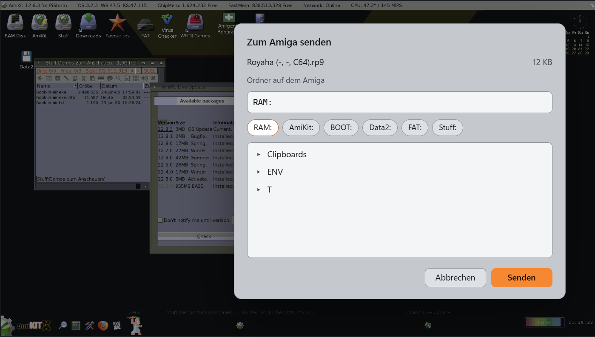
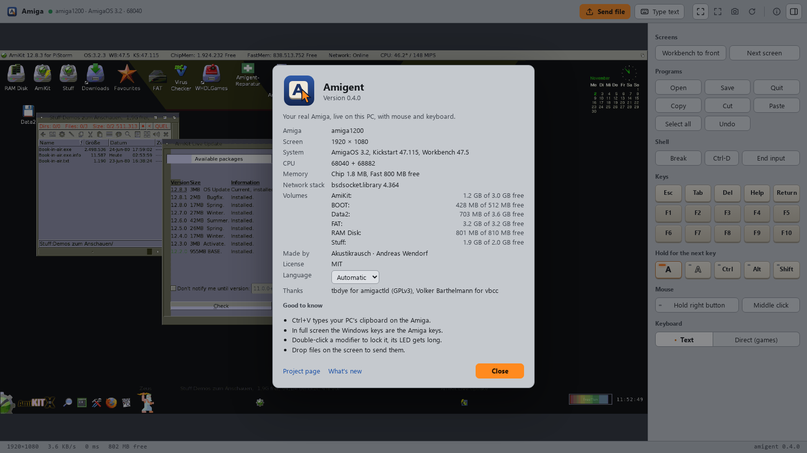

# guide

Everything the [README](../README.md) leaves out.

## Requirements in detail

Amiga: AmigaOS 3.0 or newer, a TCP/IP stack with `bsdsocket.library` such as
Roadshow, and a network connection. A plipbox on the parallel port is enough.
`amigentd` comes in two builds, one for the 68020 and up and `amigentd.000` for a
plain 68000. An RTG graphics card is optional: chipset screens, HAM included, are
read too. The screen is a lot quicker with a fast CPU, so for the remote desktop
a PiStorm or a 68040/060 card is recommended; on a 68000 it works, slowly.

PC: Python 3.10 or newer on Windows, macOS or Linux. The remote desktop uses Edge
or Chrome. For encrypted connections `openssl` on the PC and AmiSSL 5.1 or newer
on the Amiga.

## Installation by hand

Copy [`amiga/bin/amigentd`](../amiga/bin/amigentd) to the Amiga, or unpack
`amigent-1.0.0.lha` from the releases. If the Amiga has a browser or wget but
no other way in, `amigent-setup --serve` offers both builds on the network for
30 minutes and prints the address to open. Under WSL it uses Windows Python
for this, because the network does not reach servers inside WSL. Then start it: double-click the icon, or
`amigentd SETUP` in a Shell (`amigentd.000 SETUP` on a 68000). Then on the PC:

```bash
pip install -e .
```

```bash
amigent-setup 192.168.1.50
```

Without an address, `amigent-setup` searches your own /24 network. It copies
`amigentd` and the scripts to the Amiga, adds `amigentd` to `S:User-Startup`,
creates the key and, with `openssl` available, the certificate. It remembers the
Amiga under a name, "Amiga" unless you give `--name A1200`.

Register the MCP server with your agent:

```bash
claude mcp add amigent -- amigent-server
```

```bash
codex mcp add amigent -- amigent-server
```

Other agents need the command `amigent-server`. With several Amigas, give each
entry `AMIGENT_HOST` with the Amiga's name.

### When the address changes

Amigent keeps every Amiga under its name in `~/.config/amigent/amigas.json`,
with the address it last had. If the Amiga stops answering there, for example
because the router gave it a new address, Amigent searches the local /24 network
for amigentd and takes only the Amiga whose certificate (or, without TLS, whose
key) matches, so a second Amiga on the network is never mistaken for yours. The
new address is remembered for the AI agent, the remote desktop and the fleet.

When the Amiga sits in another network, the remote desktop offers a field for its
address while it does not answer, and the agent has `amiga_find` to search or to
set an address you tell it. A fixed address in the router saves the search.

## Tools for the AI agent

| tool | purpose |
|---|---|
| `amiga_exec`, `amiga_job`, `amiga_start` | run commands, long jobs and programs |
| `amiga_list`, `amiga_read_text`, `amiga_write_text` | read directories and files |
| `amiga_put`, `amiga_get` | copy files and directory trees in both directions |
| `amiga_mkdir`, `amiga_move`, `amiga_delete` | manage files |
| `amiga_screenshot` | look at the screen or a part of it, 256 colours |
| `amiga_screenshot_color` | a region in full colour, for small text and exact colours |
| `amiga_wait_change` | wait until something on the screen changes, without sending pictures |
| `amiga_screens`, `amiga_screen_front` | list all screens, bring one to the front |
| `amiga_ui_tree`, `amiga_ui_click` | windows and gadgets as text, click a gadget by its label or number |
| `amiga_menus`, `amiga_menu_select` | menus as text, pick an item by name |
| `amiga_click`, `amiga_drag`, `amiga_mouse_move`, `amiga_button` | mouse, including menus and icons |
| `amiga_type`, `amiga_key` | keyboard, through the Amiga's keymap |
| `amiga_mouse_relative` | mouse movement for games that ignore the pointer position |
| `amiga_arexx`, `amiga_rexx_ports` | ARexx commands to any program with an ARexx port |
| `amiga_break` | Ctrl-C (or D, E, F) for a running command |
| `amiga_status`, `amiga_inventory` | memory, volumes, installed programs and versions |
| `amiga_viewer` | open the remote desktop |
| `amiga_restart`, `amiga_power` | restart, and mains power if a smart plug is set up |

Gadgets without a readable label, such as GadTools buttons or MUI gadgets, come
with a small picture of each one and a number, so the agent can still click the
right one. For large files, `python -m amigent.transfer` can resume an
interrupted copy.

## Remote desktop

- **Screen.** Only the 64x64 pixel tiles that changed are transferred, the area
  around the mouse pointer first. Colours are reduced to 256.
- **Screens.** A list in the toolbar shows all open screens and brings the one
  you pick to the front.
- **Mouse and keyboard.** Click, drag, right button for menus, mouse wheel.
  *Mouse for games* captures the mouse and sends its movement instead of a
  position; Esc releases it. In text mode, characters are typed through the
  Amiga's keymap, so umlauts and AltGr characters arrive correctly. Direct mode
  sends key positions and keeps keys pressed while you hold them, for games.
- **Keyboard panel.** Esc, Tab, Del, Help, Return, F1 to F10 and both Amiga keys.
  Amiga, Ctrl, Alt and Shift can be held for the next key (one click) or locked
  (double click), plus buttons for common combinations.
- **Files.** *Send file* in the toolbar, or drag files onto the screen. You
  choose the target folder on the Amiga; the transfer is checked with a checksum
  and asks before replacing a file. *Get file* lists the Amiga's folders with
  their files, and a click saves one in the PC's downloads.
- **Clipboard.** *Amiga → PC* copies the Amiga's clipboard to the PC, *PC →
  Amiga* puts the PC's clipboard on the Amiga's, to paste there with Right
  Amiga+V. Text only.
- **Text.** *Type text* sends a block of text; Ctrl+V sends the PC's clipboard.
- **View.** Fit to window or 1:1, full screen (where the Windows or Cmd keys act
  as the Amiga keys), screenshot as PNG, and a restart that writes pending data
  to disk first.
- **System information.** The *i* button shows Kickstart and Workbench versions,
  CPU, FPU, memory, the network stack and the free space of each volume.





`amigent-viewer --install` adds Amigent to the Start menu, the desktop and
*Installed apps* on Windows (from WSL or a Windows Python), or puts `Amigent.app`
into `~/Applications` on macOS. Starting it a second time brings the open window
to the front. After an update, run `--install` again. `amigent-viewer
--uninstall` removes everything.

On macOS the app is signed with a Developer ID and notarized, the same app for
every Mac; what differs per Mac is in `~/.config/amigent/app.json`. The first
start asks for access to the local network, which it needs to reach the Amiga.
`scripts/build-mac-app.sh` builds, signs and notarizes it again; without the
signed app, `--install` builds an unsigned one with the Xcode tools.

## Several Amigas

```bash
amigent-fleet --add A1200 192.168.1.50
```

```bash
amigent-fleet
```

The overview shows every Amiga, whether it is on, its CPU, free memory and a
preview renewed every 20 seconds. A click opens its remote desktop. `--list` and
`--remove NAME` manage the list. Each Amiga needs its own key from
`amigent-setup`.

## How it works

```
  AI agent ---- MCP ---- amigent-server ---+
                                           +--- :6801 --- amigentd   screen, mouse, keys,
  browser window --- :6810 ----------------+                         commands, files
       (remote desktop, local only)
```

`amigentd` is a small daemon in C. The screen client and up to four command
channels share one port. For the screen it keeps the last picture and sends only
the 64×64 tiles that changed, run-length encoded with 256 colours. Between
requests a helper process at the lowest priority reads the screen ahead, so
asking about an unchanged screen costs one network round trip. It also reports
the screens, windows, gadgets and menus that Intuition knows. On a command
channel it runs Shell commands, reads and writes files and reports memory and
volumes; a long command doesn't hold up the screen.

Earlier installs used [amigactld](https://github.com/tbdye/amigactl) by tbdye
for commands and files. Amigent still talks to it when an older `amigentd` is
running; `amigent-setup --with-amigactld` installs it on request. amigactld is
a separate program under GPLv3, downloaded from its author and not part of this
repository.

The wire format is in [PROTOCOL.md](PROTOCOL.md).

## After a system update

A large OS or AmiKit update can remove startup entries. `amigent-repair` restores
what is missing and leaves everything else unchanged.
[`scripts/make_icon.py`](../scripts/make_icon.py) creates a desktop icon for it.
A small module per program in `repair.d` restores installed programs, their
settings and menu entries; see
[`amiga/repair.d/example.repair.txt`](../amiga/repair.d/example.repair.txt).

## Settings

| variable | default | meaning |
|---|---|---|
| `AMIGENT_HOST` | the remembered Amiga | name or address of the Amiga |
| `AMIGENT_AMIGA_DIR` | `SYS:amigent` | folder for the scripts on the Amiga |
| `AMIGENT_FLUSH_VOLUMES` | `SYS:` | volumes written to disk before a restart |
| `AMIGENT_POWER_CMD` | | command taking `on` or `off`, for a smart plug |
| `AMIGENT_VIEWER_PORT` | `6810` | port of the remote desktop, on 127.0.0.1 only |
| `AMIGENT_FLEET_PORT` | `6820` | port of the overview, on 127.0.0.1 only |
| `AMIGENT_KEY` | | key for `amigentd`, if not taken from `~/.config/amigent/` |
| `AMIGENT_TLS` | `auto` | `off` talks to `amigentd` unencrypted even with a certificate |

On the Amiga, `amigentd` takes `SETUP`, `KEY=file`, `PORT=number` and `QUIET`
from the command line or, started from Workbench, from the tool types of its
icon.

## Security

- `amigentd` asks every connection for a key. `amigent-setup` makes one per
  Amiga and stores it in `S:amigent.key` and in `~/.config/amigent/key-<address>`
  on the PC. A wrong key costs a
  one-second pause and closes the connection.
- With `openssl` on the PC and AmiSSL on the Amiga, `amigentd` also accepts TLS
  on port 6802, and the PC accepts only the certificate `amigent-setup` made for
  that Amiga. Without it the connection is unencrypted, and someone who can read
  your network traffic could read the key too.
- Setup commands only work in `SETUP` mode, which `amigent-setup` switches off.
- The remote desktop and the overview listen only on the PC itself and need the
  token in their address.

Keep the Amiga in your home network and do not forward its ports.

## Building amigentd

vbcc and the NDK are needed; AmiKit includes both. The AmigaDOS script
[`amiga/build-amigentd`](../amiga/build-amigentd) builds it on the Amiga,
`build-amigentd CPU 68000` the 68000 build. `scripts/make_release.py` packs the
archive with LhA on the Amiga. Tests for the PC side: `python3 -m pytest -q`.

## Translations

Each language of the remote desktop is one file in
[`src/amigent/web/locales`](../src/amigent/web/locales). Copy `en.json`,
translate the values, keep the `{placeholders}` and add the language code to
`LANGUAGES` in `viewer.js`. The tests report missing texts.
