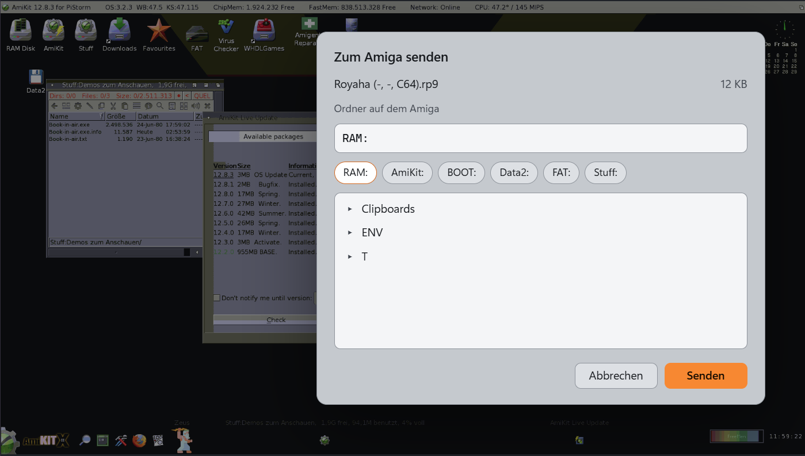
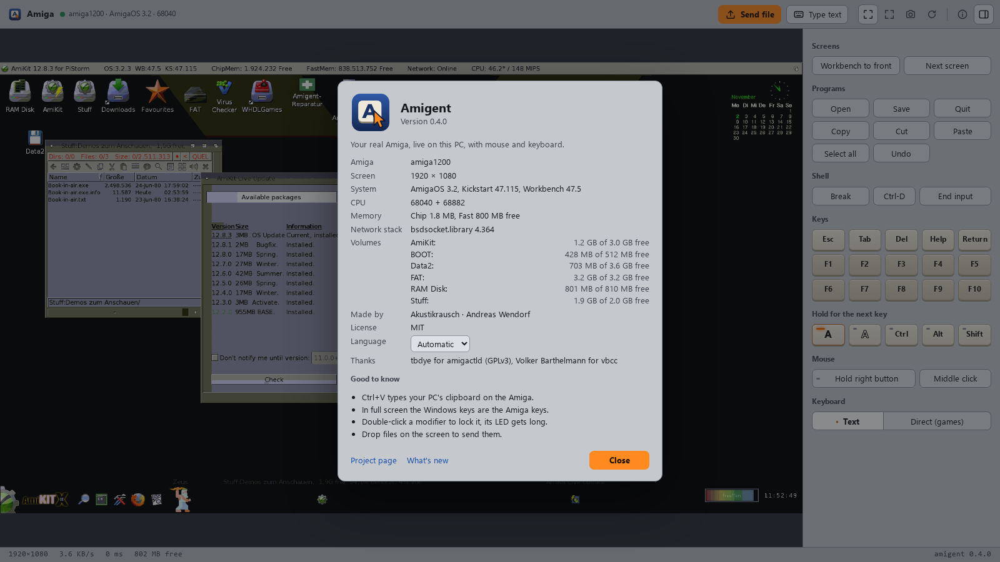

# guide

Everything the [README](../README.md) leaves out. The measurements behind the speed are in
[PERFORMANCE.md](PERFORMANCE.md).

## Requirements in detail

Amiga: AmigaOS 2.04 or newer (encryption needs OS 3.0 and AmiSSL), a TCP/IP
stack with `bsdsocket.library` such as
Roadshow, and a network connection. A plipbox on the parallel port is enough.
`amigentd` comes in builds for the 68020 and up and, as `amigentd.000`, for a
plain 68000; `amigent-setup` picks the right one. A Vampire's 68080 runs the
plain `amigentd`. An RTG graphics card is optional: chipset screens, HAM included, are
read too. A plain 68000 at 7 MHz sends a whole 640×256 Workbench screen in
about 0.6 s; a faster CPU mainly helps with large graphics-card screens.

PC: Python 3.10 or newer on Windows, macOS or Linux. The remote desktop uses Edge
or Chrome. For encrypted connections `openssl` on the PC and AmiSSL 5.1 or newer
on the Amiga.

## Manual installation

### On the Amiga

Copy [`amigentd`](../src/amigent/amiga/bin/amigentd) to the Amiga, or unpack
`amigent-1.0.0.lha` from the releases. If the Amiga has a browser or wget but
no other way in, `amigent-setup --serve` (see below) offers both builds on the
network for 30 minutes and prints the address to open. Then start it:
double-click the icon, or `amigentd SETUP` in a Shell (`amigentd.000 SETUP` on a
68000).

### Windows

Python 3.10 or newer from python.org or `winget install Python.Python.3.13`.
In a terminal (PowerShell):

```powershell
py -m pip install --user pipx; py -m pipx ensurepath
```

```powershell
pipx install amigent
```

Open a new terminal, then:

```powershell
amigent-setup
```

```powershell
amigent-viewer --install
```

Inside WSL the Linux steps below apply, and `--install` still puts Amigent into
the Windows Start menu; `--serve` then runs its server in Windows Python,
because the network does not reach servers inside WSL.

### macOS

```bash
brew install pipx && pipx ensurepath
```

```bash
pipx install amigent
```

```bash
amigent-setup
```

```bash
amigent-viewer --install
```

Allow Amigent access to the local network when macOS asks on its first start.

### Linux

Install `pipx` from the package manager, then `pipx install amigent` and
`amigent-setup`. There is no `--install`; start the remote desktop with
`amigent-viewer`.

`uv tool install amigent` works instead of pipx everywhere. To work on Amigent
itself, clone the repository and run `pip install -e .` in a virtual
environment.

### What setup does

Without an address, `amigent-setup` searches your own /24 network; with one,
for example `amigent-setup 192.168.1.50`, it goes straight there. It copies
`amigentd` (the 68000 build on a 68000) and the scripts to the Amiga, adds
`amigentd` to `S:User-Startup`, creates the key and, with `openssl` available,
the certificate. It remembers the Amiga under a name, "Amiga" unless you give
`--name A1200`.

Register the MCP server with your agent:

```bash
claude mcp add amigent -- amigent-server
```

```bash
codex mcp add amigent -- amigent-server
```

If the agent does not find `amigent-server`, give it the full path that
`pipx list` shows.

Codex asks before every tool call. To let it work on the Amiga on its own,
add to its entry in `~/.codex/config.toml`:

```toml
[mcp_servers.amigent]
default_tools_approval_mode = "approve"
```

Antigravity reads its servers from `~/.gemini/antigravity/mcp_config.json`, in
the usual `mcpServers` format. Other agents need the command `amigent-server`.
One MCP server can operate every registered Amiga. The agent calls
`amiga_machines()` to discover names, stable IDs, addresses and reachability,
then passes `machine` on each machine-specific tool call. For example:

```python
amiga_aminet_install(machine="Amiga3000", path="util/misc/example.lha", target="Work:Utilities")
amiga_aminet_install(machine="Amiga4000", path="util/misc/example.lha", target="Work:Utilities")
```

Read the package readme and check compatibility on each target first. Wrap
each machine's installation in `amiga_install_begin` and `amiga_install_end`;
run any required installer separately. Results identify the target, and each
machine keeps its own installation and undo records. A failure on one machine
does not roll back a successful installation on another.

Calls for different machines can run concurrently. Calls for the same machine
are serialized. Screen caches, connections, background log followers and
window tracking stay with their machine; there is no shared active-machine
switch. An omitted `machine` uses `AMIGENT_HOST` first, then the saved default,
then the sole registered machine. If several machines have no unique default,
pass the name or ID explicitly. Default-target calls retain their usual output and JSON format.
With several machines registered, an explicit target adds its name and address
to the reply. `amiga_everywhere` runs on all registered machines.

`AMIGENT_POWER_CMD` remains bound to the machine named by `AMIGENT_HOST` when
multiple machines are registered. It cannot switch another machine's outlet.

After updating Amigent, reconnect the MCP client so it reloads the tool schemas.
Existing separate MCP server entries with `AMIGENT_HOST` continue to work.

### When the address changes

Amigent keeps each saved Amiga under a stable internal ID in
`~/.config/amigent/amigas.json`. Renaming it preserves its credentials, notes,
installation records and inventory. Older registries migrate automatically;
the original registry and credential files are retained for recovery.

If a saved Amiga stops answering, Amigent searches the local /24 network and
accepts a new address only when its certificate or key matches. To change an
address yourself, use **Manage → Edit address**. Duplicate addresses are flagged
and must be resolved before selecting either saved machine.

Typing an IP address into **Connect** opens a one-off connection. It does not
change a saved machine's address, even when another machine was selected.
Previous addresses are migration hints, not aliases that redirect connections.

### Updating

Easiest with the AI agent. Paste this:

    Update Amigent for me, both halves: run "pipx upgrade amigent" on this
    computer, then "amigent-setup --update" for the amigentd on my Amiga.
    Then tell me to restart you, so you get the new tools.

It updates the PC side and the Amiga, whichever is behind, and needs nobody at
the Amiga. By hand:

Update the PC side as you installed it, for example `pipx upgrade amigent`.
When a new version brings a new amigentd, bring the Amiga along by network:

```bash
amigent-setup --update
```

It needs nobody at the Amiga. With several Amigas, give the name:
`amigent-setup --update A1200`. Afterwards restart the AI app (in Claude Code
`/mcp`, or the app itself) and the remote desktop, so they load the new version.

At the Amiga it works without the PC: unpack the new archive from Aminet and
double-click *Amigent-Update* in its drawer. (Double-clicking amigentd itself
only says that one runs already.) That updates only the Amiga half: run
`pipx upgrade amigent` on the PC as well and restart the AI app. From 1.3.0 on
the PC notices a newer amigentd: the agent's next answer starts with a note,
`amiga_status` lists it under `update_pc`, and the remote desktop shows a
message.

Either way key, certificate and the start line in `S:User-Startup` (`TLSONLY`
included) stay, and so does the copy for `amigent-repair` in the scripts folder,
which gets the new amigentd too. Should the new amigentd not start, the Amiga
starts the old one again.

## Tools for the AI agent

| tool | purpose |
|---|---|
| `amiga_exec`, `amiga_job`, `amiga_start` | run commands, long jobs and programs |
| `amiga_jobs`, `amiga_job_output` | the background jobs with number and return code; what a job printed so far |
| `amiga_list`, `amiga_read_text`, `amiga_write_text` | read directories and files |
| `amiga_put`, `amiga_get` | copy files and directory trees in both directions |
| `amiga_mkdir`, `amiga_move`, `amiga_delete` | manage files |
| `amiga_screen_text` | the text on the screen, window by window, with positions; far cheaper than a picture |
| `amiga_click_text` | click on visible text, such as a button label |
| `amiga_screenshot` | look at the screen or a part of it, 256 colours; or only what changed |
| `amiga_screenshot_color` | a region in full colour, for small text and exact colours |
| `amiga_wait_change` | wait until something on the screen changes, without sending pictures |
| `amiga_wait_window`, `amiga_wait_text` | wait on the Amiga until a window or a text appears or goes |
| `amiga_do` | several clicks, keys, waits and commands in one call, then one look |
| `amiga_pause_screen` | stop all screen reading for a while, so a test or benchmark has the CPU |
| `amiga_screens`, `amiga_screen_front` | list all screens, bring one to the front |
| `amiga_ui_tree`, `amiga_ui_click` | windows and gadgets as text, click a gadget by its label or number |
| `amiga_menus`, `amiga_menu_select` | menus as text, pick an item by name |
| `amiga_click`, `amiga_drag`, `amiga_mouse_move`, `amiga_button` | mouse, including menus and icons |
| `amiga_type`, `amiga_key` | keyboard, through the Amiga's keymap |
| `amiga_mouse_relative` | mouse movement for games that ignore the pointer position |
| `amiga_arexx`, `amiga_rexx_ports` | ARexx commands to any program with an ARexx port |
| `amiga_break` | Ctrl-C (or D, E, F) for a running command or a job by its number |
| `amiga_status`, `amiga_inventory` | memory, volumes, installed programs and versions; after a crash the guru in words and what happened before |
| `amiga_loaded` | libraries, devices, resources, running programs and resident modules in memory, with versions |
| `amiga_where`, `amiga_memory` | name an address (program and hunk, library function, ROM module); read memory as hex, text or 68k code; `prog hunk 4 +$10` and the vectors below $400 (ExecBase at 4) work too |
| `amiga_tasks`, `amiga_task` | all tasks with priority, state and stack, programs that run twice marked; change a priority, send Ctrl-C to F; `stack=N` names what a task waits for and its return addresses |
| `amiga_locks` | who holds the layer locks of a screen and its windows, and who waits |
| `amiga_cpu` | CPU load per task, sampled on the Amiga itself |
| `amiga_drag_measure` | drag a window by its title bar and time every step: median, p95, max, steps it did not follow |
| `amiga_quiet_monitor` | amigent-monitor stops drawing for a while, so it does not spoil a measurement |
| `amiga_software_failure` | a Software Failure requester: its text, the guru in words, and Suspend (never Reboot) |
| `amiga_trace` | tracepoints: the registers of a program when it gets to an address, without stopping it |
| `amiga_memory_write` | patch RAM, only when amigentd runs with `ALLOWPOKE` |
| `amiga_gurus` | guru codes in words, the last one and those MCP logged |
| `amiga_state` | before and after: memory, open libraries, tasks and ports, to find leaks |
| `amiga_screen_diff` | compare the screen with a saved picture: share changed, boxes, a picture of it |
| `amiga_create_project`, `amiga_build` | a new C program with a vbcc build script, compiled on the Amiga |
| `amiga_everywhere` | one command on every Amiga Amigent knows, the results compared |
| `amiga_emulator` | for an Amiga in WinUAE 6.1: start and quit it, a disk in DF0:, pause, registers, memory, the custom chips (Paula, copper, sprites), a whole-machine save before installing |
| `amiga_link` | whether data travel packed, the measured speeds, and setting it by hand |
| `amiga_install_begin`, `amiga_install_end`, `amiga_install_undo`, `amiga_installs` | installations that can be taken back |
| `amiga_aminet_search`, `amiga_aminet_readme`, `amiga_aminet_install` | find and install software from Aminet |
| `amiga_run`, `amiga_debug_log` | run a program under test, with its kprintf and Enforcer output |
| `amiga_follow` | copy a growing log or the debug output to the PC while it grows, so it survives a hang |
| `amiga_clipboard` | read or set the Amiga's clipboard |
| `amiga_notes`, `amiga_note` | what the agent learned about programs on this Amiga, for next time |
| `amiga_viewer` | open the remote desktop |
| `amiga_restart`, `amiga_power` | restart, and mains power if a smart plug is set up |
| `amiga_find` | find the Amiga again after its address changed, or set its address |

Gadgets without a readable label, such as GadTools buttons or MUI gadgets, come
with a small picture of each one and a number, so the agent can still click the
right one.

Text or picture: for information (a Shell's output, a requester's message, a
list) the agent reads the text amigentd records, a few hundred bytes. For
layout, graphics, icons and games, or when the text says something is missing,
it takes a picture, best of just that part. The remote desktop always shows
the picture.

Packing: when the Amiga packs much faster than its network carries (a PiStorm
or a 68080 behind a plipbox, say), replies, files and screen tiles travel
packed. Amigent measures both and decides; `amiga_link("off")` or
`AMIGENT_COMPRESS=off` switches it off, `fast` or `best` on. For large files, `python -m amigent.transfer` can resume an
interrupted copy.

Jobs: `amiga_job` gives every background job a number. Several can run at
once; `amiga_jobs` lists them with their return codes, `amiga_job_output`
reads what one printed so far (with amigentd 1.4.0 also while it runs; the
Shell passes output on in blocks of a few KB) and `amiga_break(job=n)` stops it.

After a crash: amigentd reports exec's last alert, and Amigent puts it in
words: `8100000C` is "exec.library: the memory list is insane; dead end". The
PC keeps the agent's last calls for each Amiga, so `amiga_status` also says
what was done and which programs ran just before the Amiga went away.

Memory and code: `amiga_loaded` shows what really runs, such as the AHI
driver in memory rather than the files on disk. `amiga_where` names an
address, for example a guru's or one from a debugging tool: program, hunk and
offset; library function through the library's jump table; or ROM module.
`amiga_memory` reads up to 64 KB of RAM or Kickstart ROM, never custom chips
or boards, as hex, text or 68k disassembly with the names of library calls
(`jsr -132(a6)` becomes `exec Forbid`). An address can be given as
`dos.library/Write`.

Emulators: WinUAE 6.1 has a GDB server. With `"gdb": "127.0.0.1:2345"` in the
Amiga's entry in `amigas.json`, and WinUAE started with
`-s debugging_features=gdbserver -s gdb_port=2345 -s cpu_threaded=false`,
`amiga_emulator` pauses and resumes the emulated CPU, reads registers and memory
even when the Amiga hangs, and saves or restores the whole machine. Then
`amiga_install_begin` also saves a state file, an undo of everything but the
disk changes.

Debugging a program: `amiga_create_project` writes `main.c` and a vbcc build
script, `amiga_build` compiles it on the Amiga, `amiga_run` runs it with its
kprintf and Enforcer output. Addresses in that output get names: a hit at
`PC: 0A12B4C0` says `myprog hunk 0 +$3D4`. `amiga_trace("set", address)` puts a
tracepoint there: when the program passes, its registers and the top of its
stack are kept and it runs on. `amiga_state` before and after a run lists what
it left: memory, open libraries, tasks, ports. `amiga_tasks` shows how much
stack each task uses, with a warning near the end. `amiga_screen_diff`
compares the screen with a saved picture, for tests of how a program looks.
`amiga_everywhere` runs one command on all known Amigas and compares.

## Remote desktop

- **Screen.** Only the 64x64 pixel tiles that changed are transferred, the area
  around the mouse pointer first. Chipset screens come in their own colours,
  graphics-card screens with 256. Your mouse and keys always go before the
  picture, so the Amiga reacts at once even while the screen is catching up.
- **Screens.** A list in the toolbar shows all open screens and brings the one
  you pick to the front.
- **Mouse and keyboard.** Click, drag, right button for menus, mouse wheel.
  *Mouse for games* captures the mouse and sends its movement instead of a
  position; Esc releases it. In text mode, characters are typed through the
  Amiga's keymap, so umlauts and AltGr characters arrive correctly. Direct mode
  sends key positions and keeps keys pressed while you hold them, for games.
- **Keyboard panel.** Esc, Tab, Del, Help, Return, F1 to F10 and both Amiga keys.
  Amiga, Ctrl, Alt and Shift can be held for the next key (one click) or locked
  (double click), plus buttons for common combinations.
- **Files.** *Send file* in the toolbar, or drag files onto the screen. You
  choose the target folder on the Amiga; the transfer is checked with a checksum
  and asks before replacing a file. *Get file* lists the Amiga's folders with
  their files, and a click saves one in the PC's downloads.
- **Clipboard.** *Amiga → PC* copies the Amiga's clipboard to the PC, *PC →
  Amiga* puts the PC's clipboard on the Amiga's, to paste there with Right
  Amiga+V. Text only.
- **Text.** *Type text* sends a block of text; Ctrl+V sends the PC's clipboard.
- **View.** Fit to window or 1:1, full screen (where the Windows or Cmd keys act
  as the Amiga keys), screenshot as PNG, and a restart that writes pending data
  to disk first.
- **Pause the picture.** *Pause the picture* in the panel stops the Amiga
  reading its screen for 1, 5 or 15 minutes, so a test, a benchmark or a demo
  has the CPU and the chip bus to itself. The window keeps the last picture and
  shows the time left; mouse, keys and files keep working. *Resume* ends it
  early. The pause holds for every client: the AI agent's screenshots wait as
  well. On the Amiga, a script can do the same through ARexx:

  ```rexx
  address AMIGENT
  'PAUSE 300'   /* seconds; without a number it tells the seconds left */
  /* ... the test ... */
  'RESUME'
  ```

- **Scripts that type.** amigentd's ARexx port also brings a window to the
  front and types into it, through the Amiga's own keymap:

  ```rexx
  address AMIGENT
  'ACTIVATEWINDOW "Shell*"'   /* rc 5 when no window title matches */
  'TYPE "dir RAM:<return>"'   /* keys in angle brackets: <ctrl c>, <lamiga q> */
  'KEY "esc"'
  'BUSY'                      /* "menu" or "held" while a menu or popup holds Intuition up */
  ```

- **System information.** The *i* button shows Kickstart and Workbench versions,
  CPU, FPU, memory, the network stack and the free space of each volume.





`amigent-viewer --install` adds Amigent to the Start menu, the desktop and
*Installed apps* on Windows (from WSL or a Windows Python), or puts `Amigent.app`
into `~/Applications` on macOS. Starting it a second time brings the open window
to the front. After an update, run `--install` again. `amigent-viewer
--uninstall` removes everything.

On macOS the app is signed with a Developer ID and notarized, the same app for
every Mac; what differs per Mac is in `~/.config/amigent/app.json`. The first
start asks for access to the local network, which it needs to reach the Amiga.
`scripts/build-mac-app.sh` builds, signs and notarizes it again; without the
signed app, `--install` builds an unsigned one with the Xcode tools.

## Several Amigas

Run `amigent-viewer` to see **Your Amigas** when several machines are registered.
With one saved machine it opens that desktop directly. An explicit name, such
as `amigent-viewer "Amiga 2"`, opens that machine.

The selector remains available in every desktop and overview. It lists each
machine's name, address and connection status. **Manage** provides **Rename**,
**Set default**, **Edit address** and **Remove**. Removing an entry keeps its
credentials and history on disk. The default is used by tools that need one
machine; the viewer still shows the overview when several are registered.

Reachability refreshes every 20 seconds without taking over another viewer's
screen connection. The fleet overview also samples previews, OS, CPU and memory
while the page is open. Each Amiga needs its own credentials from `amigent-setup`.

The same controls are available from the command line:

```bash
amigent-fleet --add A1200 192.168.1.50
amigent-fleet --rename A1200 "Desk Amiga"
amigent-fleet --default "Desk Amiga"
amigent-fleet --address "Desk Amiga" 192.168.1.51
amigent-fleet --list
amigent-fleet --remove "Desk Amiga"
```

Adding a machine never replaces an existing machine's address. Use the explicit
address control to correct a saved mapping. `amigent-fleet` also opens the
overview directly.

## How it works

```
  AI agent ---- MCP ---- amigent-server ---+
                                           +--- :6801 --- amigentd   screen, mouse, keys,
  browser window --- :6810 ----------------+                         commands, files
       (remote desktop, local only)
```

`amigentd` is a small daemon in C. The screen client and up to four command
channels share one port. For the screen it keeps the last picture and sends only
the 64×64 tiles that changed. Chipset screens go out as the bitplanes the Amiga
keeps anyway, so a 68000 has almost nothing to convert; graphics-card screens go
out as tiles with their own small palette. Each tile is packed, often as the
difference to the picture the PC already has, or to the same picture scrolled.
Mouse and keys sent during a picture are carried out between its tiles. A
helper process at the lowest priority notices changes by comparing the planes
in chip RAM, so asking about an unchanged screen costs one network round trip
and the Amiga only a few percent of its CPU. It also reports
the screens, windows, gadgets and menus that Intuition knows. On a command
channel it runs Shell commands, reads and writes files and reports memory and
volumes; a long command doesn't hold up the screen.

Earlier installs used [amigactld](https://github.com/tbdye/amigactl) by tbdye
for commands and files. Amigent still talks to it when an older `amigentd` is
running; `amigent-setup --with-amigactld` installs it on request. amigactld is
a separate program under GPLv3, downloaded from its author and not part of this
repository.

The wire format is in [PROTOCOL.md](PROTOCOL.md).

## After a system update

A large OS or AmiKit update can remove startup entries. `amigent-repair` restores
what is missing and leaves everything else unchanged.
[`scripts/make_icon.py`](../scripts/make_icon.py) creates a desktop icon for it.
A small module per program in `repair.d` restores installed programs, their
settings and menu entries; see
[`amiga/repair.d/example.repair.txt`](../amiga/repair.d/example.repair.txt).

## Settings

| variable | default | meaning |
|---|---|---|
| `AMIGENT_HOST` | the remembered Amiga | name or address of the Amiga |
| `AMIGENT_AMIGA_DIR` | `SYS:amigent` | folder for the scripts on the Amiga |
| `AMIGENT_FLUSH_VOLUMES` | `SYS:` | volumes written to disk before a restart |
| `AMIGENT_POWER_CMD` | | command taking `on` or `off`, for a smart plug |
| `AMIGENT_VIEWER_PORT` | `6810` | port of the remote desktop, on 127.0.0.1 only |
| `AMIGENT_FLEET_PORT` | `6820` | port of the overview, on 127.0.0.1 only |
| `AMIGENT_KEY` | | key for `amigentd`, if not taken from `~/.config/amigent/` |
| `AMIGENT_TLS` | `auto` | `off` talks to `amigentd` unencrypted even with a certificate |
| `AMIGENT_GDB` | | `host:port` of WinUAE's GDB server, when not set as `"gdb"` in `amigas.json` |
| `AMIGENT_WINUAE` | | WinUAE's program, when not set as `"winuae"` in `amigas.json` |

An Amiga's entry in `amigas.json` can also hold `"gdb"`, `"winuae"`,
`"winuae_config"` (its `.uae` file, for `amiga_emulator("launch")`) and
`"devpack"` (the folder with vbcc and the NDK, for `amiga_build`).

On the Amiga, `amigentd` takes `SETUP`, `KEY=file`, `PORT=number`, `QUIET`,
`TLSONLY` and `ALLOWPOKE` (writing memory) from the command line or, started from Workbench, from the tool types
of its icon. It answers ARexx on the port `AMIGENT` (`STATUS`, `CLIENTS`,
`VERSION`, `PAUSE`, `RESUME`, `ACTIVATEWINDOW`, `TYPE`, `KEY`, `BUSY`, `HELP`, `QUIT`;
see [the protocol](PROTOCOL.md#arexx)), and `amigent-status` shows the same in a small
window. `amigent-monitor` opens a window that lists what the agent does: each tool
it calls and the commands, files, clicks and keys that reach `amigentd`. Its tool
types: `NAME` (for the greeting), `WIDTH`, `HEIGHT`, `LEFT`, `TOP`, `FONT`, `SIZE`
(a fixed-width font). The window can be sized, and its zoom gadget switches
to a compact size; below 56 columns the side panel gives way to the log. Esc
or the close gadget ends it, C clears the log.

## Security

- `amigentd` asks every connection for a key. `amigent-setup` makes one per
  Amiga and stores it in `S:amigent.key` on the Amiga and in `~/.config/amigent/`
  on the PC. A wrong key costs a one-second pause and closes the connection.
- With `openssl` on the PC and AmiSSL on the Amiga, `amigentd` also accepts TLS
  on port 6802, and the PC accepts only the certificate `amigent-setup` made for
  that Amiga. Once that works, `amigent-setup` starts `amigentd` with `TLSONLY`:
  other computers then get in only encrypted (`--allow-plain` keeps the plain
  port open). Without TLS the connection is unencrypted, and someone who can
  read your network traffic could read the key too.
- Setup commands only work in `SETUP` mode, which `amigent-setup` switches off.
- The remote desktop and the overview listen only on the PC itself and need the
  token in their address.

Keep the Amiga in your home network and do not forward its ports.

## Building amigentd

vbcc and the NDK are needed; AmiKit's DevPack includes both. The AmigaDOS
script [`amiga/build-amigentd`](../amiga/build-amigentd) builds it on the Amiga
in the folder with `amigentd.c`; `CPU 68000 TO amigentd.000` makes the 68000
build, `DEVPACK Work:DevPack` points it to another DevPack folder. `scripts/make_release.py` packs the
archive with LhA on the Amiga. Tests for the PC side: `python3 -m pytest -q`.

A cross compiler on the PC works too: `m68k-amigaos-gcc -O2 -m68020 -noixemul -s
-o amigentd amiga/amigentd.c` (checked with GCC 16 from the
`amigadev/crosstools:m68k-amigaos` Docker image; `-m68000` for the 68000
build). The released binaries are vbcc's.

## Translations

Each language of the remote desktop is one file in
[`src/amigent/web/locales`](../src/amigent/web/locales). Copy `en.json`,
translate the values, keep the `{placeholders}` and add the language code to
`LANGUAGES` in `viewer.js`. The tests report missing texts.
